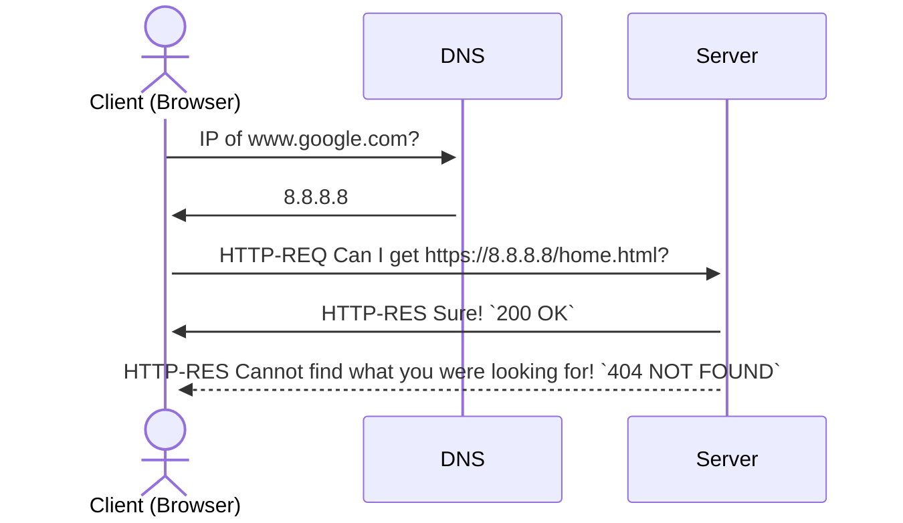

+++

title = "Web Intro - HTML, CSS, JS"
description = "A Hugo theme for creating Reveal.js presentations"
outputs = ["Reveal"]
aliases = [
    "/guide/"
]

+++

{}
# Introduzione al **Web**
{}

## HTML, CSS, JavaScript

<small>

A cura di Nicholas Magi

`nicholas.magi[at]ispascalcomandini.it`

</small>

<br>

<br>
{}

---
{}

# Il Web

{{% callout type="cite" src="[Enciclopedia Treccani]" srcLink="https://www.treccani.it/enciclopedia/web_%28Enciclopedia-Italiana%29/" %}}
Il **web** (abbreviazione di *world wide web*, 'ragnatela mondiale', spesso indicato brevemente anche come www) è un sistema di **interconnessione tra documenti** basato sull'infrastruttura di Internet che permette l'accesso a tutta l'informazione disponibile su computer collegati in rete.
{}

---

### Sul **web** possono essere disponibili **qualsiasi tipo di documenti**.

Immagini, video, audio, documenti Word, PDF...

---

### Architettura **Client-Server** 


---

### Cosa succede quando si fa una richiesta sul web?



{}

---

## Web standards

- Tecnologie utilizzate per costruire **siti web**.

### Princìpi chiave

1. Libera contribuzione e utilizzo
2. Accessibilità
3. Retrocompatibilità

---

## Dispense di un "vecchio" seminario

"**[React for Dummies / Web Basics](
https://github.com/Nickolausen/react-for-dummies/tree/master/web-basics)**", corso pomeridiano PNRR **@** I.T.T. "Blaise Pascal"

---

{}


<br>

<small>
<a href="https://www.flaticon.com/free-icons/html" title="html icons">Html icons created by Freepik - Flaticon</a>
</small>


## **HTML**
### **H**yperText **M**arkup **L**anguage

[Guida di riferimento: MDN Docs](https://developer.mozilla.org/en-US/docs/Web/HTML)

---

### Linguaggio di markup
- come $\LaTeX{}$, markdown, XML...
- definisce la *struttura* e il *contenuto* di una pagina

<br>
<br>

{} 
**Non è un linguaggio di programmazione**!
{}

---


---

## HTML: **Tag**

- Una pagina si compone di un insieme di **tag**:
  - ogni tag è composto da un **nome** (*case insensitive*) circondato da `<` e `>`;
  - per ogni tag possono essere specificati alcuni attributi coppia `nome="valore"` che specifica alcune proprietà dell’elemento

---

{}
{}

### Codice sorgente

```html { linenos=inline hl_lines=["4", "15"] }
<!DOCTYPE html> 
<!-- Dichiaro il tipo di documento -->

<html>
  <!-- Parte di metadati della pagina -->
    <head>
      <title>Il mio bellissimo sito</title>
    </head>

    <!-- Contenuto della pagina -->
    <body>
      <p>Lorem Ipsum Ipse Dixit</p>
        <a href="www.google.com">Mi sento fortunato</a>
    </body>
</html>
```
{}
In evidenza il tag `<html>`, **radice** della pagina.
{}

{}
{}

### Render

<iframe height="500"
  sandbox
  srcdoc="<!DOCTYPE html> 
<!-- Dichiaro il tipo di documento -->

<html>
  <!-- Parte di metadati della pagina -->
    <head>
      <title>Il mio bellissimo sito</title>
    </head>

    <!-- Contenuto della pagina -->
    <body>
      <p>Lorem Ipsum Ipse Dixit</p>
        <a href="www.google.com">Mi sento fortunato</a>
    </body>
</html>">
</iframe>
{}

{}

---

## Semantica dei tag


Ogni tag deve essere usato in accordo con il **contenuto che deve rappresentare**.

---

## Tag di sectioning 

{}
{}
```html { linenos=inline }
<!DOCTYPE html>

<html>
  ...
  <body>
      <header>
          <nav>
              ...
          </nav>
      </header>

      <main>
          <aside>
              ...
          </aside>
          <div>
              <section>
                  ...
              </section>
              <article>
                  ...
              </article>
          </div>
          <aside>
              ...
          </aside>
      </main>
      
      <footer>
          ...
      </footer>
  </body>
</html>
```
{}
{}


{}
Scheletro del codice sorgente e render corrispondente (*decorato con CSS!*)
{}

{}
{}

---

#### Alcuni tag fondamentali
### ``

- ``
  - `src`: percorso dell’immagine (salvata nel filesystem o sul web)
  - `alt`: testo alternativo (mostrato quando l’immagine non viene caricata correttamente)

---

#### Alcuni tag fondamentali
### `<a></a>`

`<a href="www.google.com" target="_blank">Clicca qui</a>`
  - `href`: URL del tag.
  - `target`: specifica dove deve essere aperto quel link — `_blank` indica “in una nuova tab”.

---

## Attributi

- Ce ne sono tanti, alcuni visti poco fa (`href`, `target`, `src`, `alt`...)
- Alcuni sono **universali** — comuni a tutti i tag esistenti:
    - <mark><code>class</code></mark>
    - <mark><code>id</code></mark>
    - `style`
    - `data-`
    - ...

---

## Attributi
<mark><code>class</code> vs <code>id</code></mark>
- **`class`**: identifica un **gruppo di elementi** a cui voglio attribuire caratteristiche comuni.
- **`id`**: identifica un **singolo elemento** della mia pagina.

Entrambi permettono di interagire con il documento HTML tramite **fogli di stile** o **script esterni**.

---

## Attività **#01**


https://it.gravatar.com/

{}

---

{}


## **CSS**
### **C**ascading **S**tyle **S**heet

---

### Cascading Style Sheet
- Tecnologia particolarmente odiata, ma comunque **fondamentale** — è *ovunque*;
- Ha l'importante compito di separare il **contenuto** dalla sua **presentazione**
  - definisce infatti <mark><b>come</b></mark> un contenuto HTML deve essere presentato

<br>
<br>

{} 
**Non è un linguaggio di programmazione**!
{}

---


---

### Importare un foglio di stile
1. foglio di <mark>stile <b>inline</b></mark> 
    - attributo `style` del tag che voglio stilare
2. foglio di <mark>stile <b>interno</b></mark>  
    - importato in `<head>` dal tag `<style>`
3. foglio di <mark>stile <b>esterno</b></mark>  
    1. importato in `<head>` dal tag `<style>`
    2. importato in `<head>` dal tag `<link>`

---

#### 1. CSS inline

```html { linenos=inline hl_lines=["2"] }
...
    <header style="color:blue;">
        <h1>Monsters and Co.</h1>
    </header>
...
```

<br/>
{}
**Pessimo**, mischia il contenuto e la presentazione. 
{}

---

#### 2. CSS in `<head>`
```html { linenos=inline hl_lines=["2-8"] }
...
    <head>
        <style type="text/css">
            header {
                color: blue;
            }
        </style>
    </head>
    <body>
        <header>
            <h1>Monsters and Co.</h1>
        </header>
    </body>
...
```

{}
Iniziamo ad isolare contenuto e presentazione, ma ancora siamo dentro ad HTML.
{}

---

#### 3.1 Foglio esterno

{}
{}
```html { linenos=inline hl_lines=["5-7"]}
<!DOCTYPE html>

<html>
  <head>
      <style type="text/css">
        @import url("styles.css");
      </style>
  </head>
  <body>
    <header>
      <h1>Monsters and Co.</h1>
    </header>
  </body>
</html>
```
`index.html`
{}
{}
```css
header {
  color: blue;
}
```
`styles.css`
{}
{}

{}
Inusuale, ma ci siamo! Esiste tuttavia un'alternativa — più diffusa.
{}

---

#### 3.2 Foglio esterno

{}
{}
```html { linenos=inline hl_lines=["5"]}
<!DOCTYPE html>

<html>
  <head>
    <link rel="stylesheet" href="styles.css">
  </head>
  <body>
    <header>
      <h1>Monsters and Co.</h1>
    </header>
  </body>
</html>
```
`index.html`
{}
{}
```css
header {
  color: blue;
}
```
`styles.css`
{}
{}

{}
Noi facciamo così!
{}

---

## Funzionamento
- Un foglio di stile si compone di una serie di regole, scritte una dopo l'altra;
  - queste vengono applicate a **cascata** (non a caso il linguaggio si chiama *Cascade Style Sheet*), 
    - partendo dall'alto e scendendo in maniera sequenziale fino alla fine del foglio;
  - logica da tenere a mente per evitare eventuali <mark><b>conflitti</b></mark> tra <mark>diverse regole</mark> applicate ad uno <mark>stesso elemento</mark>;

---

## Sintassi

{}
{}

### In generale
```css
selettore {
  proprietà: valore;
}
```
{}
{}

### Esempio
```css
a[href="https://www.google.com"] {
  text-decoration: none;
  color: red;
  font-weight: bold;
}
```
{}
{}

<table>
  <thead>
    <tr>
      <td>#</td>
      <td>specifica</td>
      <td>esempio</td>
    </tr>
  </thead>
  <tbody>
    <tr>
      <td><code>selettore</code></td>
      <td>a chi applicare le regole di stile</td>
      <td><code>div</code>, <code>.nav-link</code>...</td>
    </tr>
    <tr>
      <td><code>proprietà</code></td>
      <td>caratteristica di stile assegnabile ad un elemento</td>
      <td><code>margin</code>, <code>padding</code>...</td>
    </tr>
  </tbody>
</table>

---

## Selettori, pt. 01
Più utilizzati
| **Tipologia**     | **Selettore**        |
|---------------|------------------:|
| universale    | `*`                |
| di tipo       | `E`                |
| di prossimità | `E{ ,>,+,~}F`      |
| di classe     | `E{.,#}main-title` |

---

## Selettori, pt. 02

| **Tipologia**                    | **Selettore**                     |
|------------------------------|-------------------------------:|
| di pseudo-classi             | `E:link`, `E:hover`               |
| di pseudo-classi strutturali | `E:first-child`, `E:nth-child(n)` |
| di pseudo-elementi           | `E:before`, `E:after`             |
| di attributi                 | `E[attr]`                       |

<br>

{}
E ce ne sono tanti altri! [[MDN Docs]](https://developer.mozilla.org/en-US/docs/Web/CSS/Guides/Selectors)
{}

---

## Selettori
{}
{}

### Elemento HTML

```html
<div id="provaID"></div>
```
{}

{}

### Foglio CSS

```css
div#provaID { 
  background-color: red; 
}

div.provaClasse { 
  background-color: blue; 
}

div { 
  background-color: green; 
}
```
{}
{}

> Di quale colore sarà lo sfondo del `div`?

---

## Priorità delle regole
{}
{}
In ordine **decrescente** di importanza
1. Media
2. Importanza di una dichiarazione
3. Origine della dichiarazione
4. Specificità del selettore
5. Ordine delle dichiarazioni
{}

{}
{}
`!important` fornisce **max. priorità**:
```css
p { 
  font-size: 3px !important; 
}
```
{}
{}
{}

---

## Specificità dei selettori

Ogni selettore CSS ha una **specificità**, i.e. una quadrupla $(x,y,w,z)$, dove
- $x$: vale 1 se la dichiarazione dello stile avviene in nell'attributo `style`, 0 altrimenti
- $y$: numero di **id** specificati nel selettore
- $w$: numero di **classi**, **attributi** e **pseudo-classi** specificati nel selettore
- $z$: numero di **elementi** e **pseudo-elementi** specificati nel selettore

<br/> 
<br/> 

{}
A parità di Media, Importanza e Origine, avrà precedenza la regola con specificità **maggiore**!
{}

---

## Breve esercizio

Quali specificità $(x,y,w,z)$ hanno i seguenti selettori?

<br>

{}
{}
```css
/* #01 */
li {

}

/* #02 */
nav ul li:first-line {
  
}

/* #03 */
nav.menu ul.sec li {

}

/* #04 */
nav ul li a[href=‘/home’] {

}

/* #05 */
nav#menu ul.sec li#st a {

}
```
{}
{}

<i style="font-size: 4em;" class="my-auto bi bi-patch-question"></i>

{}
{}

---

## Breve esercizio

Quali specificità $(x,y,w,z)$ hanno i seguenti selettori?

<br>

{}
{}
```css
/* #01 */
li {

}

/* #02 */
nav ul li:first-line {
  
}

/* #03 */
nav.menu ul.sec li {

}

/* #04 */
nav ul li a[href=‘/home’] {

}

/* #05 */
nav#menu ul.sec li#st a {

}
```
{}
{}

| **#**  | $x$ | $y$ | $w$ | $z$ | $(x,y,w,z)$ |
|----|---|---|---|---|-----------|
| **01** | $0$ | $0$ | $0$ | $1$ | $(0,0,0,1)$ |
| **02** | $0$ | $0$ | $0$ | $4$ | $(0,0,0,4)$ |
| **03** | $0$ | $0$ | $2$ | $3$ | $(0,0,2,3)$ |
| **04** | $0$ | $0$ | $1$ | $4$ | $(0,0,1,4)$ |
| **05** | $0$ | $2$ | $1$ | $4$ | $(0,2,1,4)$ |

{}
{}

---

## Box Model


---

<small>

Guida: [CSS-Tricks](https://css-tricks.com/snippets/css/a-guide-to-flexbox/)

</small>

<br/>


## Flexbox

Sistema di **suddivisione** e **distribuzione** dello spazio che favorisce adattabilità alle dimensioni dello schermo, anche quando la dimensione degli elementi da disporre non è conosciuta a priori.

<small>

Impara con le rane: https://flexboxfroggy.com/

</small>

---

## **<i class="bi bi-bootstrap-fill"></i>** Bootstrap

> Framework per lo sviluppo **front-end** *free* e *open-source*.

<br/>

- Sviluppato da <i class="bi bi-twitter"></i> Twitter
- Applicazioni **responsive** e **mobile-first**
  - **responsive** := il layout degli elementi si aggiusta al ridimensionamento dello schermo
  - **mobile-first** := il layout degli elementi è pensato in primis per essere visto da telefono

---

<small>

> This diagram shows the percentages of websites using various CSS frameworks. See technologies overview for explanations on the methodologies used in the surveys. Our reports are updated daily.

> How to read the diagram:
80.7% of the websites use none of the CSS frameworks that we monitor.
Bootstrap is used by 14.4% of all the websites, that is a CSS framework market share of 74.5%.

</small>


<small class="text-muted">

Sorgente: https://w3techs.com/technologies/overview/css_framework 

(aggiornato al 13/05/2026)

</small>

---

### Killer feature: **grid system**


Spazio divisibile in **12 colonne**, adattabili a seconda della dimensione della **viewport**.

---

## "Installazione"

{}
{}
### **#01.** In locale 


<small>

https://getbootstrap.com/docs/5.3/getting-started/download/

</small>

{}
{}
### **#02.** Tramite CDN 

Aggiungi `<link>` e `<script>` alla pagina HTML


<small>

https://getbootstrap.com/

</small>

{}
{}

---

### Alternativa per differenziare i siti generati con **Bootstrap**

**Bootswatch** — https://bootswatch.com/

{}

---

{}


## **JS**
### **J**ava**S**cript

---

### **J**ava**S**cript

- Linguaggio interpretato*, debolmente tipizzato e **prototype-based**
  - *compilato **JIT** (*Just-In Time*)
  - concetto di prototipo di un oggetto
    - istanza primaria, astratta, sempre accessibile che può essere clonata e modificata in un qualunque momento — *anche a run-time*!

<br>
<br>

{}
Unico **linguaggio di programmazione** tra i tre!
{}

---

### Dichiarazioni variabili

3 possibilità:

<br>

{}

{}
#### LET

`let person = /*..*/`
{}
{}
#### CONST
`const person = /*..*/`

Preferibile quando non si deve cambiare il valore ad una variabile.
{}
{}
#### VAR
Bandita!
{}

{}

---

### Tipizzazione dinamica e debole

```js
let today = new Date()
today = "Monday"
today = 4
```

Il tipo di dato viene dedotto in fase di esecuzione (*run-time*); nell'esempio:
1. `today` parte con il tipo di `Date`
2. passa a `String`
3. diventa `Number`

<br>
<br>

> Istruzioni lecite!

---

### I tipi di dato **primitivi**

{}
{}
#### Numerici

- `Number`
  - raccoglie tutto: interi e con la virgola;
    - anche il valore `NaN` (*Not a Number*)
```js
let myNumberFromConstructor = Number("5")
let myDoubleNumber = 3.14
let mySuspiciousNumber = Number("JavaScript")

console.log(mySuspiciousNumber) // NaN
console.log(typeof mySuspiciousNumber) // Number
``` 

- `BigInt`
  - numeri non rappresentabili con `Number`
    - troppo grandi (o troppo piccoli)
  - no numeri con la virgola!
  - unico limite: la memoria a disposizione

```js
let myBigInteger = BigInt("12345678901234567890")
```
{}
{}
#### Non-numerici
- `String`
  - rappresentabili con le doppie virgolette "", o anche quelle singole ''

```js
let firstValidString = 'ciao a tutti!'
let secondValidString = "questa è una stringa"
let interpolated = `${firstValidString} ${secondValidString}`
```

<small>
    Per l'interpolazione si usano i backtick!
</small>

<br>

- `Boolean` $\rightarrow$ `true` | `false`
- `Symbol`
- `Undefined`
- `Null`

{}
{}

---

{}
È `undefined` tutto ciò che è stato dichiarato, ma che non ha valore; è `null` ciò che volutamente ha ricevuto valore `null`.
{}

<br>

{}
{}
```js
let myName;
console.log(myName) // undefined
console.log(typeof myName) // undefined
```
{}
{}
```js
let myName = null;
console.log(myName) // null
console.log(typeof myName) // object
```
{}
{}

---

### Gli **oggetti**

{}
{}

#### Classe

```js
class Person {
  
  #firstName
  #surname

  constructor(name, surname) {
    this.#firstName = name
    this.#surname = surname
  }

  greetings() {
    return `Hi! 
      I am ${this.#firstName} 
      ${this.#surname}`
  }
}

// ---

const pinco = new Person(
  "Pinco", "Pallino"
)
console.log(pinco.greetings())
```

{}
{}

#### Prototipo

```js
function Person(name, surname) {
  this.firstName = name
  this.surname = surname
}

const pinco = new Person(
  "Pinco", "Pallino"
)

Person.prototype.greetings = function () {
  return `Hi! 
    I am ${this.firstName} 
    ${this.surname}`
}

console.log(pinco.greetings())
```

{}
{}

#### JSON Notation

```js
const pinco = {
  firstName: "Pinco",
  surname: "Pallino",
  greetings: function() {
    return `Hi! 
      I am ${this.firstName} 
      ${this.surname}`
  }
}

console.log(pinco.greetings())
```

{}
{}

---

### **Strutture dati**

{}
{}
#### Liste / Array
```js 
const numbers = [1, 2, 3]
// Stile fluente!
const transformed = numbers
    .map(n => n * 3) 
    .filter(n => n % 2 === 0)
    .every(n => n > 2)

// 1. Create a list (Array)
const fruits = ["apple", "banana", "orange"];

// 2. Add elements
fruits.push("mango");       // Appends to the end
fruits.unshift("strawberry"); // Inserts at the beginning

// 3. Access and update by index
console.log(fruits[0]);     // Output: "strawberry"
fruits[1] = "green apple";  // Updates the element at index 1

// 4. Remove elements
const lastItem = fruits.pop();   
// Removes and returns the last element ("mango")
const firstItem = fruits.shift(); 
// Removes and returns the first element ("strawberry")

// 5. Check existence
// Output: true
console.log(fruits.includes("banana")); 

// 6. Iterate through elements
fruits.forEach((fruit, index) => {
  console.log(`${index}: ${fruit}`);
});
```
{}
{}
#### Mappe
```js 
const map = new Map();

map.set("a", 1);
map.set("b", 2);
map.set("c", 3);

console.log(map.get("a"));
// Expected output: 1

map.set("a", 97);

console.log(map.get("a"));
// Expected output: 97

console.log(map.size);
// Expected output: 3

map.delete("b");

console.log(map.size);
// Expected output: 2
```
{}

{}
#### Set

```js

// 1. Create an empty Set
const numbers = new Set();

// 2. Add elements using .add()
numbers.add(10);
numbers.add(20);
// Duplicate value: ignored automatically
numbers.add(10); 
console.log(numbers.size); // Output: 2

// 3. Check for existence using .has() 
console.log(numbers.has(20)); // Output: true
console.log(numbers.has(99)); // Output: false

// 4. Remove an element using .delete()
numbers.delete(10);

// --- COMMON USE CASE: 
// Removing duplicates from an array ---
const itemsWithDuplicates = [
  "apple", "pear", 
  "apple", "banana"];

// Pass the array to the Set constructor, 
// then spread it back into an array
const uniqueItems = [
  ...new Set(itemsWithDuplicates)
];

console.log(uniqueItems); 
// Output: ["apple", "pear", "banana"]
```
{}
{}

{}

---

{}


## **TS**
### **T**ype**S**cript

---

### I **problemi** di **JavaScript**

- Tipizzazione **debole** e **dinamica**
  - molti errori vengono scoperti solo a *run-time* (programma in esecuzione)
- Comportamenti **imprevedibili**
  - `[] + {}` $\rightarrow\ ?$
  - `"5" - 1` $\rightarrow\ ?$
- Difficoltà di **refactoring**
  - progetti medio/grandi difficilmente manutenibili e scalabili
- Mancanza di autocompletamento
  - assenza di **IntelliSense**

---

### **Perché** **T**ype**S**cript / 1

{}
{}
- **Superset tipizzato di JavaScript**, open-source e sviluppato da Microsoft
  - stesso progettista di C#!
- **"Superset"**
  - il codice JavaScript rimane *valido* in TypeScript
- **Compatibilità** con i browser/JS runtime (Node, Bun, Deno...)
  - il codice TypeScript deve essere convertito in codice JavaScript
  - particolare compilatore chiamato "**transpiler**"
    - sottile differenza dal concetto tradizionale di compilatore
- **Zero overhead**
  - la tipizzazione è presente solo a **compile-time**
  - una volta "traspilato", **i tipi spariscono completamente** 
{}
{}

{}
{}

---

### **Perché** **T**ype**S**cript / 2

{}

{}
#### Rilevamento errori <br> a **compile-time**

Gli errori vengono segnalati ancor prima di avviare il programma.
{}
{}
#### Developer experience
IntelliSense, documentazione inline delle funzioni, navigazione rapida del codice.
{}
{}
#### Refactoring e manutenibilità
I tipi fungono da documentazione aggiornata, bassa probabilità di rompere codice con manovre di refactoring.
{}

{}

---

### I tipi base

{}
{}
- Tipi primitivi: 
  - `string`, 
  - `number`, 
  - `boolean`, 
  - `null`, 
  - `undefined`
{}
{}
- Array e tuple: `T[]`, `[T, U]`
  - per esempio: 
    - `number[]`, 
    - `[number, string]`
{}
{}
#### Type inference
TS capisce il tipo di dato e lo inferisce ad una variabile, senza bisogno di annotarlo

```ts
let messaggio: string = "Ciao Mondo";

// TS deduce automaticamente 'number'
let count = 42; 

// TS capisce che si tratta di 'number[]'
let numbers = [1, 2, 3, 4, 5] 
```
{}

{}

---

### **Type** vs **Interface**

{}
{}
#### **Interface**
- Costrutto ideale per modellare oggetti, 
- Estendibile con `extends`
- Adatta per architetture ad oggetti e API pubbliche
{}
{}
#### **Type**
- Costrutto versatile
- Supporto alle operazioni **insiemistiche tra tipi**
{}
{}

--- 

### Qualche esempio di `type` / 1

#### Union (`|`) e Intersection (`&`)

```ts
// Union (OR): one of those possible values
type RequestStatus = "idle" | "loading" | "success" | "error";

// ---

type Timestamped = {
  createdAt: Date;
  updatedAt: Date;
};

type Product = {
  id: string;
  title: string;
  price: number;
};

// Intersection (AND): combines all properties from both types
type TrackedProduct = Product & Timestamped;

const item: TrackedProduct = {
  id: "prod-101",
  title: "Mechanical Keyboard",
  price: 89.99,
  createdAt: new Date(),
  updatedAt: new Date(),
};
```

---

### Qualche esempio di `type` / 2

```ts
type Action =
  | { type: "LOGIN"; payload: { userId: string } }
  | { type: "LOGOUT" }
  | { type: "UPDATE_EMAIL"; payload: { newEmail: string } };

function handleAction(action: Action) {
  switch (action.type) {
    case "LOGIN":
      // TypeScript automatically narrows the type: payload and userId are guaranteed
      console.log("Logged in user:", action.payload.userId);
      break;
    case "LOGOUT":
      // payload does not exist on this branch
      console.log("User logged out");
      break;
    case "UPDATE_EMAIL":
      console.log("New email:", action.payload.newEmail);
      break;
  }
}
```

---

### Qualche esempio di `type` / 3

```ts
type AppConfig = {
  port: number;
  host: string;
  debugMode: boolean;
};

// Extracted union: "port" | "host" | "debugMode"
type ConfigKey = keyof AppConfig;

// Lookup type: resolves to number
type PortType = AppConfig["port"];

function getConfigValue(config: AppConfig, key: ConfigKey) {
  return config[key];
}
```

---

### Qualche esempio di `type` / 4

#### Built-in types: `Partial<>`, `Pick<>`, `Omit<>`, `Record<>` 

```ts
type User = {
  id: number;
  username: string;
  email: string;
  passwordHash: string;
};

// 1. Partial: marks every field as optional (ideal for PATCH payloads)
type UpdateUserDto = Partial<User>;

// 2. Pick: selects only the specified keys
type PublicProfile = Pick<User, "id" | "username">;

// 3. Omit: excludes specific sensitive keys
type SafeUser = Omit<User, "passwordHash">;

// 4. Record: constructs an object type with specific keys and values
type Permission = "read" | "write" | "admin";
type RolePermissions = Record<Permission, boolean>;

const guestPermissions: RolePermissions = {
  read: true,
  write: false,
  admin: false,
};
```

---

### Qualche esempio di `interface` / 1

#### **Ereditarietà** su **più livelli**

```ts
interface BaseEntity {
  id: string;
  createdAt: Date;
}

// Single extension: Person inherits id and createdAt
interface Person extends BaseEntity {
  firstName: string;
  lastName: string;
  email: string;
}

// Chained extension: Employee inherits from Person (and transitively from BaseEntity)
interface Employee extends Person {
  salary: number;
  role: "junior" | "mid" | "senior";
  hiredAt: Date;
}

const developer: Employee = {
  id: "emp-42",
  createdAt: new Date("2024-01-01"),
  firstName: "Jane",
  lastName: "Doe",
  email: "jane.doe@example.com",
  salary: 85000,
  role: "senior",
  hiredAt: new Date("2024-03-01"),
};
```

---

### Qualche esempio di `interface` / 2

#### **Composizione** di interfacce

```ts
interface Sizable {
  width: number;
  height: number;
}

interface Stylable {
  backgroundColor: string;
  borderColor?: string;
}

interface Clickable {
  onClick: (event: MouseEvent) => void;
}

// Composes three distinct behaviors into a single UI contract
interface ButtonProps extends Sizable, Stylable, Clickable {
  label: string;
  disabled: boolean;
}

const submitButton: ButtonProps = {
  width: 140,
  height: 44,
  backgroundColor: "#0070f3",
  label: "Submit Form",
  disabled: false,
  onClick: (e) => console.log("Clicked at coordinates:", e.clientX, e.clientY),
};
```

---

### Qualche esempio di `interface` / 3

#### **Restringimento** / **sovrascrittura** delle proprietà

```ts
interface GenericItem {
  id: string | number;
  payload: unknown;
}

// Narrows 'id' strictly to string and provides a concrete shape for 'payload'
interface ArticleItem extends GenericItem {
  id: string;
  payload: {
    title: string;
    tags: string[];
  };
}
```

---

### Funzioni tipizzate

```ts
function calcolaTotale(prezzo: number, sconto: number = 0): number {
  return prezzo - sconto;
}
```

---

### **Installazione** di TypeScript

1) Assicurarsi di avere NodeJS installato 
  > in un terminale, digitare `node --version` <br>
  > (output atteso: una versione di node, tipo `v24.13.1`)
2) All'interno di un progetto, sempre da terminale, scrivere
  > `npm install -D typescript` <br>
  > (`-D`: salva come dipendenza del progetto - equivale a `--save-dev`)
3) Per compilare un file `.ts`: 
  > `npx tsc app.ts`

---

{}
{}
### **NodeJS**
#### Il file `package.json`

Identità del progetto, indicazione delle dipendenze necessarie, script eseguibili (`npm run dev`, `npm test`...)

{}
"Lista dei desideri, astratta e flessibile".
{}

{}

{}
### **NodeJS**
#### Il file `package-lock.json`

Dipendenze con versioni precise, URL di download, hash crittografico per certificare l'autenticità del file.

{}
"Fotografia del progetto, fissata e deterministica".
{}
{}

{}
### **TS**-Only
#### Il file `.tsconfig`

Cuore di ogni progetto TypeScript - configurazioni della logica del transpiler.

{}
Parametri importanti:
1) `target`: versioni del JS in output;
2) `strict: true`: abilita controlli rigorosi
3) `moduleResolution`: gestisce import/export
4) `noImplicitAny`: impedisce `any` impliciti
{}


{}
{}

{}